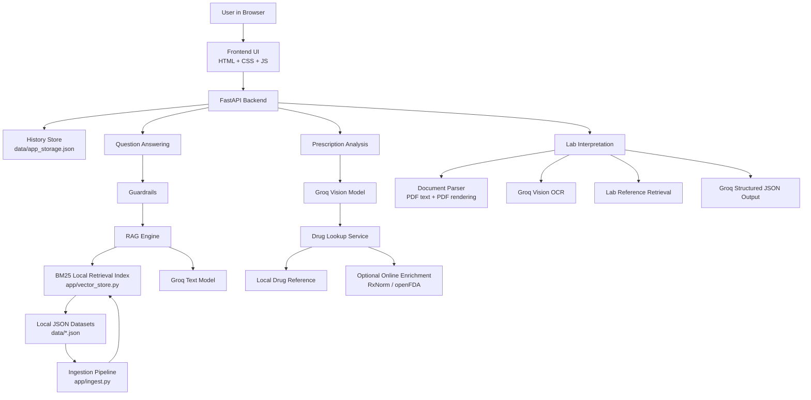

# MediReference AI

Medical RAG workspace for:

- grounded medical question answering
- prescription image reading
- lab report interpretation from text, images, and PDFs
- multilingual output, including Indian languages
- local saved history for chats, prescriptions, and lab reports

This project uses a FastAPI backend, a lightweight static frontend, Groq for text and vision tasks, and a local BM25 retrieval index built from JSON datasets.

## What It Can Do

### 1. Medical question answering with citations

- Answers medical, medication, and lab-related questions from the local knowledge base
- Returns source cards with title, source, domain, category, update date, and retrieval score
- Shows confidence and guardrail status for each answer
- Gives short fallback replies when a question is unrelated or when no relevant medical data is available

### 2. Guardrailed medical RAG

- Blocks obvious prompt-injection attempts
- Detects urgent/emergency language and responds with emergency guidance instead of a normal RAG answer
- Avoids personalized treatment advice by framing answers as educational guidance
- Refuses to over-answer when retrieval support is weak or irrelevant

### 3. Prescription image analysis

- Upload a prescription image
- Uses Groq vision to extract likely medicines and visible dosage text
- Looks up normalized medicine information from the local drug reference
- Explains common uses of the extracted medicines
- Stores each prescription analysis locally so it survives refresh

### 4. Lab report interpretation

- Paste raw lab report text and get a structured interpretation
- Upload lab report images
- Upload PDF lab reports
- Reads text PDFs directly
- Falls back to OCR for scanned PDFs
- Extracts markers, generates warnings, and saves each interpretation locally

### 5. Multilingual support

- Response language selector in the UI
- Supports:
  - English
  - Hindi
  - Telugu
  - Tamil
  - Kannada
  - Malayalam
  - Bengali
- Multilingual inputs are normalized to English for retrieval when needed

### 6. Persistent local history

- Chat sessions are saved locally
- Prescription analyses are saved locally
- Lab report interpretations are saved locally
- Refreshing the page does not wipe previous work
- Saved items can be reopened later
- Chats, prescriptions, and lab reports can be deleted from history

### 7. Local dataset ingestion

- Loads all compatible JSON data files from the `data/` folder
- Rebuilds the local retrieval index from the UI
- Supports expanding the knowledge base without changing the frontend

## Architecture



## How It Works

### Question answering flow

1. User sends a medical question
2. Guardrails check for emergency language, prompt injection, and scope
3. The question is normalized to English if needed
4. The app retrieves matching local context using BM25
5. Groq generates a grounded answer from only the retrieved context
6. The answer, citations, confidence, and session history are saved locally

### Prescription analysis flow

1. User uploads a prescription image
2. Groq vision extracts likely medicine names and visible instructions
3. Drug lookup maps the result to local medicine references
4. The app returns common uses, notes, warnings, and confidence
5. The record is saved in local history

### Lab report flow

1. User pastes text or uploads an image/PDF
2. The app extracts readable report text
3. Lab markers are matched against local lab-reference data
4. Groq generates a constrained interpretation
5. The result is saved in local history

## Tech Stack

- Backend: FastAPI
- Frontend: HTML, CSS, vanilla JavaScript
- LLM / Vision: Groq
- Retrieval: local BM25 index
- PDF parsing: PyMuPDF
- Persistence: local JSON storage

## Project Structure

```text
.
|-- app/
|   |-- document_parser.py
|   |-- drug_lookup.py
|   |-- guardrails.py
|   |-- history_store.py
|   |-- ingest.py
|   |-- lab_service.py
|   |-- llm_providers.py
|   |-- models.py
|   |-- prescription_service.py
|   |-- rag_engine.py
|   `-- vector_store.py
|-- chroma_db/
|-- data/
|   |-- app_storage.json
|   |-- clinical_guidelines.json
|   |-- drug_reference.json
|   `-- lab_reference.json
|-- frontend/
|   |-- app.js
|   |-- index.html
|   `-- styles.css
|-- config.py
|-- main.py
`-- requirements.txt
```

## Getting Started

### Prerequisites

- Python 3.12 recommended
- Groq API key

### 1. Install dependencies

```powershell
py -3.12 -m pip install --user -r requirements.txt
```

### 2. Configure environment

Create a `.env` file:

```env
LLM_PROVIDER=groq
GROQ_API_KEY=your_groq_api_key_here
GROQ_TEXT_MODEL=llama-3.3-70b-versatile
GROQ_VISION_MODEL=meta-llama/llama-4-scout-17b-16e-instruct
DEFAULT_LANGUAGE=English
ENABLE_ONLINE_DRUG_LOOKUP=true
```

### 3. Run the app

```powershell
py -3.12 main.py
```

Then open:

[http://localhost:8005](http://localhost:8005)

## Data Format

The ingestion pipeline reads every compatible `*.json` file in `data/` except the local app storage file.

Each dataset should follow this shape:

```json
{
  "guidelines": [
    {
      "id": "UNIQUE-ID-001",
      "domain": "Pharmacology",
      "title": "Metformin",
      "source": "openFDA drug labeling",
      "category": "Drug Reference",
      "content": "Grounded source summary text.",
      "key_recommendations": [
        "Used for type 2 diabetes",
        "Check product-specific dosing"
      ],
      "last_updated": "2026-04-26",
      "aliases": ["Glucophage"]
    }
  ]
}
```

### Rebuild the local index

- Use the `Rebuild Local Index` button in the UI
- Or call `GET /api/ingest`

## API Overview

### Core

- `POST /api/query` - ask a medical question
- `GET /api/health` - health and config summary
- `GET /api/ingest` - rebuild the local retrieval index

### Chat history

- `GET /api/chats`
- `GET /api/chats/{session_id}`
- `DELETE /api/chats/{session_id}`

### Prescription analysis

- `POST /api/prescription/analyze`
- `GET /api/prescriptions`
- `GET /api/prescriptions/{record_id}`
- `DELETE /api/prescriptions/{record_id}`

### Lab reports

- `POST /api/lab-report/interpret`
- `POST /api/lab-report/analyze-file`
- `GET /api/lab-reports`
- `GET /api/lab-reports/{record_id}`
- `DELETE /api/lab-reports/{record_id}`

## Guardrails

This project includes practical guardrails for a medical education workflow:

- prompt-injection pattern blocking
- emergency query detection
- educational-only framing for personal medical questions
- unrelated-topic detection
- no-relevant-data fallback when the dataset does not support the question
- image file type and file size validation

## Notes and Limitations

- This is an educational medical RAG app, not a clinical decision system
- The retrieval layer currently uses local BM25 keyword retrieval, not dense embeddings
- Prescription OCR and lab OCR can be wrong on poor-quality images
- Answers are only as good as the local dataset you ingest
- The app should not be used for diagnosis, prescribing, or urgent care decisions

## Suggested Dataset Expansion

- drug labels from openFDA
- brand/generic normalization from RxNorm
- richer label text from DailyMed
- more lab marker references
- India-specific public guidelines from ICMR, MoHFW, and NCDC

## Disclaimer

This software is for educational and training use only. It is not a substitute for professional medical judgment, diagnosis, or treatment. Always consult a qualified clinician or pharmacist for real-world care decisions.
